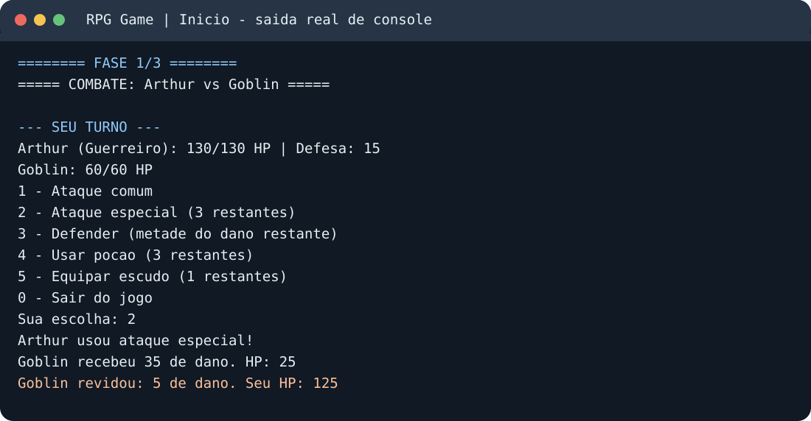
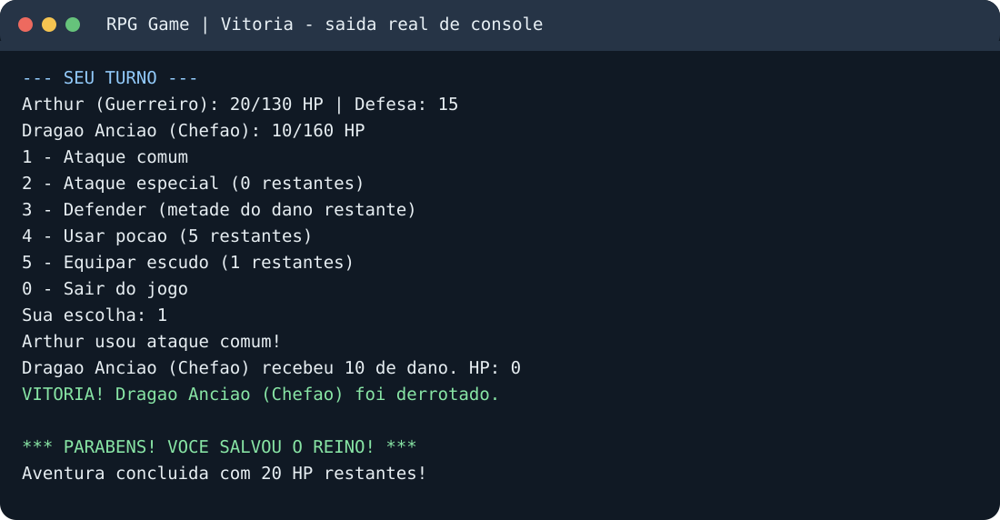

# RPG Game | Paradigmas de Programação

**Java 17+ · RPG jogável em console · POO e SOLID**

Projeto de RPG em Java desenvolvido para a disciplina de Paradigmas de Programação. Apresenta orientação a objetos (encapsulamento, abstração, herança, composição e polimorfismo), um jogo funcional em turnos e exemplos dos **cinco princípios SOLID**.

## Demonstração

O jogador seleciona **Guerreiro, Mago ou Arqueiro**, escolhe o nome do personagem e enfrenta **Goblin**, **Esqueleto Guerreiro** e **Dragão Ancião (chefão)**. Vida e inventário são preservados entre as fases.

> Os registros visuais foram renderizados a partir de saídas de uma execução real do jogo em Java; são reproduções do texto do terminal, não fotografias do VS Code.

## Requisitos e execução

- **JDK 17 ou superior**, com os comandos java e javac no PATH.
- Sem banco de dados, dependências, Maven, Gradle ou bibliotecas externas.
- No terminal (inclusive PowerShell) aberto **na raiz do repositório**:

~~~bash
javac -encoding UTF-8 -d out -sourcepath src src/rpg/Main.java
java -cp out rpg.Main
~~~

No VS Code, abra **src/rpg/Main.java** e execute a classe **rpg.Main**. O jogo inicia com a seleção de classe e nome.

## Comandos durante a batalha

| Opção | Ação | Efeito |
| --- | --- | --- |
| 1 | Ataque comum | Ataque do herói menos defesa do inimigo |
| 2 | Ataque especial | Dano característico da classe; **3 usos por batalha** |
| 3 | Defender | Não ataca; reduz pela metade o dano após desconto da defesa, arredondando para cima |
| 4 | Poção de cura | Recupera até **30 HP**; não é consumida com vida cheia |
| 5 | Equipar escudo | Soma **+3 defesa**, permanente na aventura |
| 0 | Sair | Encerra a aventura |

Ações válidas gastam um turno e permitem revide do inimigo sobrevivente. Opções inválidas, uso de poção com HP cheio e tentativas sem itens/especiais **não** gastam turno. O herói começa com três poções e um escudo e recebe uma poção após cada uma das duas primeiras vitórias.

## Organização do código

~~~text
src/rpg/
  Main.java                     Inicio
  Jogo.java                     Selecao e sequencia de fases
  personagens/
    Personagem.java             Atributos e regras de vida/dano
    Heroi.java                  Classe abstrata dos herois
    HabilidadeEspecial.java     Interface
    Guerreiro.java
    Mago.java
    Arqueiro.java
  inimigos/
    Inimigo.java                Classe abstrata dos inimigos
    Goblin.java
    Esqueleto.java
    Dragao.java
  combate/
    Combate.java                Turnos e acoes
    ResultadoCombate.java       Enum de resultados
  inventario/
    Inventario.java             Lista de itens
  itens/
    Usavel.java                 Interface de itens consumiveis
    Equipavel.java              Interface de equipamentos
    PocaoCura.java
    EscudoReforcado.java
  io/
    InterfaceUsuario.java       Contrato de interacao
    ConsoleUI.java              Adaptador para Scanner
tests/rpg/TestesRpg.java        Testes independentes de frameworks
docs/arquitetura.md             Detalhamento tecnico e SOLID
docs/diagrama-classes.md        Diagrama de classes UML em Mermaid
docs/screenshots/               Registros visuais da execucao
.github/workflows/java-ci.yml   Compilacao e testes automaticos
~~~

## Conceitos de POO

- **Encapsulamento:** atributos de Personagem são privados; os métodos receberDano, curar e aumentarDefesa controlam alterações de estado.
- **Abstração:** Personagem, Heroi e Inimigo são classes abstratas; itens e interação com o terminal usam interfaces.
- **Herança:** Guerreiro, Mago e Arqueiro estendem Heroi; Goblin, Esqueleto e Dragao estendem Inimigo.
- **Polimorfismo:** cada herói implementa ataqueEspecial com valor próprio; Combate aceita qualquer Heroi ou Inimigo concreto.
- **Composição:** Combate utiliza um Inventario, um Heroi, um Inimigo e uma InterfaceUsuario recebidos em seu construtor.

## Aplicação dos cinco princípios SOLID

| Princípio | Evidência no código | Benefício |
| --- | --- | --- |
| **S — SRP (Responsabilidade Única)** | Personagem (estado e dano), Combate (turnos), Inventario (itens), ConsoleUI (entrada e saída), Jogo (fluxo da campanha) | A regra de batalha não se mistura à leitura de teclado ou à guarda de itens. |
| **O — OCP (Aberto/Fechado)** | Combate trabalha com Heroi e Inimigo; Inventario usa as interfaces Usavel e Equipavel | Um novo inimigo ou um novo item pode ser integrado sem reescrever o motor de combate ou o inventário. O menu de seleção de herói ainda requer atualização para listar novas classes. |
| **L — LSP (Substituição de Liskov)** | Heróis e inimigos concretos respeitam os contratos de suas classes-base; testes exercitam combinações | Trocar Guerreiro por Mago/Arqueiro, ou Goblin por Esqueleto/Dragao, não quebra as regras básicas de combate. |
| **I — ISP (Segregação de Interfaces)** | HabilidadeEspecial, Usavel e Equipavel | Inimigos não são forçados a implementar especial; poções não precisam se equipar e escudos não precisam ser consumidos. |
| **D — DIP (Inversão de Dependências)** | Jogo e Combate recebem InterfaceUsuario; ConsoleUI implementa essa interface; UIEmMemoria é usada nos testes | O motor não depende diretamente de Scanner/System.out e pode ser testado com entradas simuladas. |

Para justificativas técnicas adicionais, consulte [Arquitetura](docs/arquitetura.md).

## Diagrama UML

O [diagrama de classes completo](docs/diagrama-classes.md) usa Mermaid, exibido diretamente pelo GitHub, e mostra as relações de herança, implementação de interfaces, agregação e associação.

## Testar

A execução dos testes não requer JUnit.

**Linux/macOS:**

~~~bash
javac -encoding UTF-8 -d out $(find src tests -name '*.java')
java -cp out rpg.TestesRpg
~~~

**Windows PowerShell:**

~~~powershell
$arquivos = Get-ChildItem src,tests -Recurse -Filter *.java | ForEach-Object FullName
javac -encoding UTF-8 -d out $arquivos
java -cp out rpg.TestesRpg
~~~

Os testes cobrem regras de dano e cura, itens, limite de especial, entrada inválida, substituição de subclasses e conclusão da campanha. O GitHub Actions também compila e executa essa suíte após os commits na branch master.

## Observação acadêmica

Trabalho individual desenvolvido com apoio de IA para aprendizado, revisão, implementação e depuração, permitido pelo enunciado. O autor deve compreender o código entregue e estar apto a explicar decisões de POO, SOLID e o comportamento do programa.
