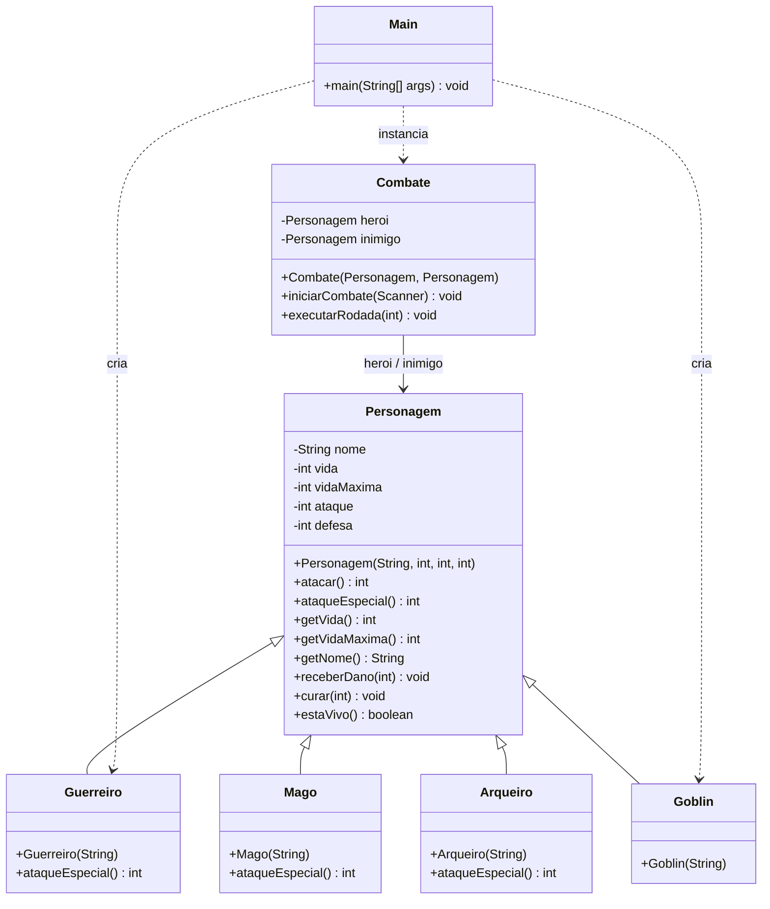

# Diagrama de classes UML

Representa **a versão atual** do código, com as relações de herança e dependência.

**Observação:** o desenho será atualizado quando adicionarmos novas classes de inventário, interação no console e outras mecânicas. Não representa requisitos ainda não implementados.
